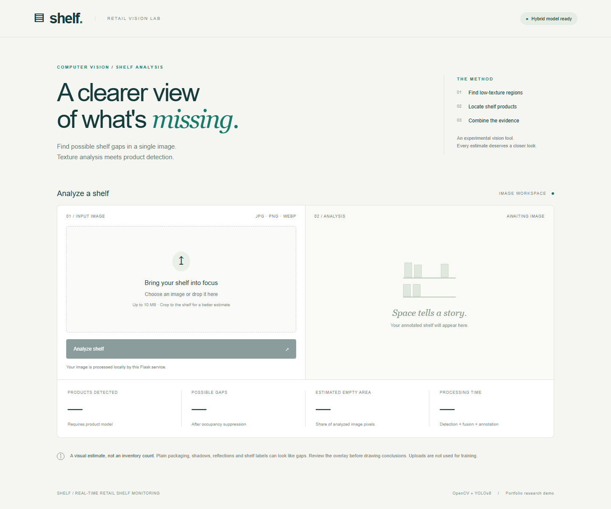
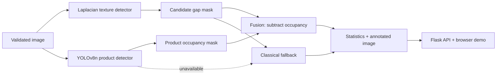

# Real-Time Retail Shelf Monitoring

An end-to-end research portfolio project that combines interpretable texture analysis with a fine-tuned YOLOv8 product detector to flag possible empty shelf regions in uploaded images.



> The gap result is a visual heuristic. It is not a physical shelf-capacity measurement or an inventory count.

## Problem

Reviewing shelf images manually does not scale well. A visually plain region can indicate a missing facing, but it can also be a shadow, a uniform package, a shelf label, signage or background. Product localization supplies a second occupancy signal that can suppress some of these false candidates.

## Solution



The modules are independent: [gap detection](app/services/gap_detector.py), [YOLOv8 adapter](app/services/product_detector.py), [fusion](app/services/fusion.py), [orchestration](app/services/analyzer.py), and [Flask API](app/api.py). See the detailed [architecture and contracts](docs/architecture.md).

## Why hybrid CV?

The classical layer exposes its exact low-texture mask and works without a learned model. The YOLOv8 layer recognizes product-shaped occupancy that texture alone can confuse with empty space. Fusion subtracts padded product boxes from the candidate mask and recalculates connected components and pixel area. Both raw and fused summaries remain in the JSON response for inspection.

If the weight file or Ultralytics dependency is missing, model loading fails, or inference raises a defined recoverable error, the service logs the cause and stays available in `classical_fallback` mode. It reports product count as `null`, because unavailable is different from zero.

## Classical gap detection

The default pipeline, after bounded resizing, is:

1. BGR → grayscale.
2. Float32 3×3 Laplacian.
3. 15×15 local mean absolute edge energy.
4. Candidate threshold below 12.
5. 5×5 elliptical morphological opening and closing.
6. 8-connected component filtering: area ≥600 px, width ≥15 px, height ≥15 px.
7. Exact nonzero mask pixels divided by all processed-image pixels.

These settings are centralized in [configuration](app/config.py) and exposed through environment variables. Pixel thresholds apply after resize. Crop images to the shelf because automatic shelf ROI detection is outside this version.

## Product detector and measured evaluation

The application requires a single-class YOLOv8 detection checkpoint (`product` or `object`). It rejects generic COCO weights at serving time. The local checkpoint was initialized from official COCO-pretrained `yolov8n.pt` and then fine-tuned on the documented SKU-110K subset.

| Item | Actual local run |
|---|---|
| Model | YOLOv8n, single `product` class |
| Input resolution | 416 × 416 |
| Epochs / batch | 8 / 4 |
| Optimizer | Ultralytics auto-selected AdamW, lr 0.002, momentum 0.9 |
| Device | CPU, 12th Gen Intel Core i5-12500H |
| Seed / workers | 42 / 0, deterministic requested |
| Train / validation / test | 64 / 12 / 12 images |
| Test instances | 1,769 product boxes |
| Precision | **0.4887** |
| Recall | **0.4064** |
| mAP@50 | **0.3624** |
| mAP@50–95 | **0.1455** |

These are real results from a very small feasibility subset, not full SKU-110K benchmark results and not evidence of broad retail generalization. The exact [evaluation JSON](results/yolo_evaluation.json), [training configuration](results/training/cpu_feasibility_config.json), epoch CSV, checkpoint SHA-256 record, and package lock are included. Large weights stay outside Git.

## Dataset

SKU-110K was selected after reviewing public shelf datasets and implementations. The [original authors](https://github.com/eg4000/SKU110K_CVPR19) allow the dataset exclusively for academic and non-commercial use. [Ultralytics documents](https://docs.ultralytics.com/datasets/detect/sku-110k) 11,743 single-class shelf images, split 8,219 train / 588 validation / 2,936 test, with an approximate 13.6 GB download.

This project actually downloaded 88 images (83,594,550 image bytes): the first 64 train, 12 validation, and 12 test records from the pinned `benjamintli/sku110k` mirror revision. Original splits were preserved. Every image hash, dimension and box count is stored in the [dataset manifest](results/dataset_manifest.json). The fixed-prefix subset is convenient and reproducible but is not claimed to represent full real-world diversity. Dataset files are ignored by Git.

Source, usage terms, alternatives, mirror limitations, and public implementation patterns are recorded in [research notes](docs/research.md). Preparation instructions are in [data/README.md](data/README.md).

## System benchmark

Warm serial inference was measured on the same 12 test images, five timed repetitions after three warm-up calls, on Windows 11 with the Intel Core i5-12500H CPU, PyTorch 2.14.0 CPU, Ultralytics 8.4.146, OpenCV 5.0.0.93 and four compute threads. The timed region includes resize, CV, optional YOLO, fusion and annotation; it excludes decode, HTTP, disk I/O and model loading.

| Mode | Mean | Median | p95 | Throughput |
|---|---:|---:|---:|---:|
| Classical only | 89.85 ms | 94.18 ms | 119.81 ms | 11.13 images/s |
| Hybrid | 218.42 ms | 233.77 ms | 267.36 ms | 4.58 images/s |

The complete [benchmark JSON](results/benchmarks/local_cpu.json) contains every timing sample, image hash, resolution and configuration. Throughput is `1000 / mean latency` for serial warm processing, not concurrent Flask capacity.

## API

```text
GET  /health
POST /api/analyze              multipart field: image
GET  /results/<analysis_id>.jpg
```

Example fallback response shape (numbers depend on the uploaded image):

```json
{
  "analysis_id": "8e1c...",
  "mode": "classical_fallback",
  "yolo_available": false,
  "products_detected": null,
  "raw_gap_count": 27,
  "gap_count": 27,
  "estimated_empty_area_percentage": 20.1556,
  "processing_time_ms": 128.4,
  "annotated_image_url": "/results/8e1c....jpg"
}
```

The real response also includes detections, gap boxes, exact mask-pixel areas, raw/fused summaries, diagnostics, coordinate space and processed/original dimensions. Uploads are restricted by extension, decoded format, request bytes and image pixel count. Result IDs accept only 32 lowercase hex characters; annotations expire and are capped locally.

## Local setup

Python 3.12 was used for the measured run.

```powershell
python -m venv .venv
.\.venv\Scripts\Activate.ps1
python -m pip install -r requirements-yolo.txt
Copy-Item .env.example .env
python run.py
```

Open `http://127.0.0.1:5000`. With no local shelf checkpoint, the app starts in classical fallback. To enable hybrid mode, place a trusted, single-class YOLOv8 checkpoint at `models/shelf_yolov8n.pt` or set `YOLO_MODEL_PATH`, then restart.

The exact direct versions from this run are in `requirements-local-lock.txt`. The project imports no secrets for normal local use.

## Reproduce data, training and evaluation

Review [dataset terms and provenance](docs/research.md) before downloading.

```powershell
python -m scripts.prepare_dataset --accept-research-terms --train 64 --val 12 --test 12
python -m scripts.train_yolo --data data/sku110k/dataset.yaml --model yolov8n.pt --epochs 8 --imgsz 416 --batch 4 --device cpu --seed 42 --threads 4 --name cpu_feasibility
python -m scripts.evaluate_yolo --data data/sku110k/dataset.yaml --weights models/shelf_yolov8n.pt --split test --imgsz 416 --device cpu --batch 4 --output results/yolo_evaluation.json
```

For a larger GPU experiment, use [the Colab notebook](notebooks/train_yolov8_colab.ipynb). It still uses a subset by default and does not contain pre-filled results.

## Inference, benchmark and tests

```powershell
python -m scripts.infer data/sku110k/images/test/test_00000.jpg
python -m scripts.infer data/sku110k/images/test/test_00000.jpg --classical-only
python -m scripts.benchmark --images data/sku110k/images/test --runs 5 --warmup 3 --output results/benchmarks/local_cpu
python -m scripts.failure_analysis --images data/sku110k/images/test --limit 6
pytest -q
python -m scripts.audit
```

The final local suite passes **40 tests**. It covers upload validation, oversized requests, pixel limits, deterministic classical output, exact mask-area arithmetic, morphology/component filtering, product adapter clipping, model-family rejection, fusion occupancy suppression, load and inference fallback, unexpected-error propagation, API endpoints, safe result handling, expiry and result caps.

## Failure analysis and limitations

Six held-out images were reviewed qualitatively. The detector often marks floors, ceilings, signs, shelf fascia, shadows and uniform package faces because they have low texture. It can miss narrow gaps after component filtering. Product recall is limited, so many product-shaped classical candidates remain. Details and per-image outputs are in the [failure analysis](docs/failure_analysis.md).

- There is no verified gap ground truth, so no quantitative gap accuracy is claimed.
- `estimated_empty_area_percentage` is image-mask coverage, not calibrated shelf capacity.
- Thresholds are resolution, crop, lighting, contrast and shelf-layout dependent.
- The small subset and 8-epoch CPU run have limited product localization accuracy.
- Product domain shift, tightly packed products, dark packaging, reflections and occlusion remain difficult.
- The service processes uploaded still images. It is not a deployed camera network, SKU recognizer, planogram engine or inventory system.
- The Flask development server and local result store are intended for demonstration, not production exposure.

## Repository hygiene

Datasets, trained weights, generic base weights, caches, virtual environments, run directories, generated uploads, logs and local analyzed screenshots are excluded by `.gitignore`. The repository audit checks common credential patterns, generated/large artifacts and local Markdown links. No GitHub push has been performed.

## Tech stack

Python · OpenCV · NumPy · Ultralytics YOLOv8 · PyTorch · Flask · Pillow · pytest · lightweight HTML/CSS/JavaScript
