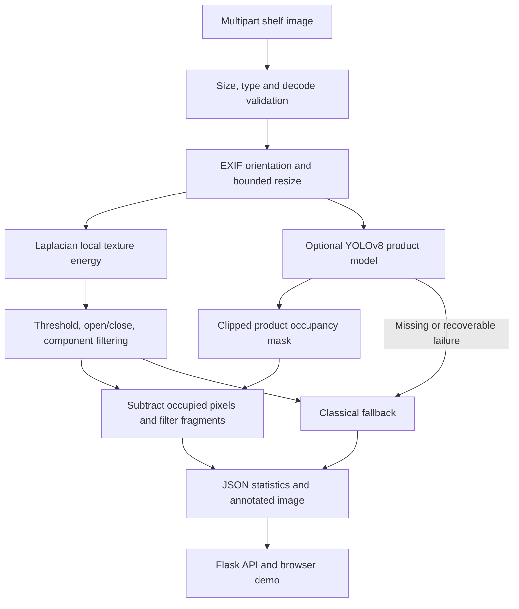

# Architecture and contracts

`Settings` is immutable and environment configurable. `GapDetector`, `ProductDetector`, `fuse`, and `Analyzer` can be used without Flask. The app factory supports dependency injection for isolated tests.

## Classical pipeline

1. Image is decoded as RGB, EXIF orientation applied, converted to BGR, then resized without upscaling to maximum side 1280.
2. Convert to grayscale; compute OpenCV float32 Laplacian with kernel size 3.
3. Mean absolute Laplacian in a 15×15 local window is the texture energy.
4. Energy below 12 becomes a candidate pixel. This threshold is an initial engineering setting, not a statistically optimized threshold.
5. Elliptical 5×5 morphological opening followed by closing cleans speckles and small holes.
6. 8-connected component filtering retains area ≥600 pixels, width ≥15 and height ≥15. Region boxes use exclusive right/bottom bounds.
7. Empty-area estimate is `100 * count_nonzero(mask) / (processed_width * processed_height)`. It uses actual mask pixels, preserves holes, and does not sum bounding rectangle areas.

There is no automatic shelf ROI estimation: the denominator is the entire processed image. Crop to shelf content before upload. Thresholds are resolution sensitive.

## Product adapter and fusion

The model must be a YOLOv8 detection architecture and have one `product` or `object` class. Generic COCO models are rejected. At inference: confidence ≥0.25, input 416, CPU by default, maximum 1,000 detections. Boxes are clipped to image dimensions, converted into a union occupancy mask and padded by 3 pixels. Candidate pixels underneath products are removed; connected fragments are filtered again. No subsequent closing can fill product-occupied pixels back in.

Removing pixels cannot increase the estimated empty percentage. Gap count can increase when a product divides one region into two. Neither change proves better accuracy: false product detections can erase true gaps and missed products leave false gaps.

## Degradation and errors

Missing weights, import failure, model load failure and recoverable inference exceptions latch the detector into classical fallback until restart. The model adapter catches a defined set of runtime/data/dependency exceptions and logs stack traces. Unexpected exceptions such as programming `TypeError` propagate to the API's logged, sanitized 500 response. `products_detected` is null in fallback, not zero. An available model with zero boxes is still hybrid.

Model prediction is protected by a lock because Ultralytics predictors retain mutable state. The demo is a single-process local service; multiple workers would each load their own model and require a shared, coordinated result store.

## API contract

- `GET /` serves the demo.
- `GET /health` returns liveness, current mode and YOLO availability; fallback is healthy service operation.
- `POST /api/analyze`, multipart field `image`, supports JPEG, PNG and WebP. Maximum request size defaults to 10 MiB including multipart framing; decoded pixel count is limited to 20 million.
- `GET /results/<32-character-hex-id>.jpg` retrieves a generated image. Arbitrary paths are never accepted. Results expire after one hour and are capped at 100 files; pruning occurs on subsequent analyses. Expired images are refused even before physical pruning.

Raw and fused summaries include component boxes and exact mask areas. CLI inference additionally saves both masks. Every coordinate is in the processed image, explicitly described by `coordinate_space` and `processed_size`; original dimensions are returned. Timings cover resize, CV, optional YOLO, fusion and annotation. HTTP upload, decode, JPEG encoding and disk write are excluded.

The raw upload is not saved by the API. Annotations contain the submitted scene and are local temporary files. There is no authentication or production hosting configuration; bind to loopback as documented.
